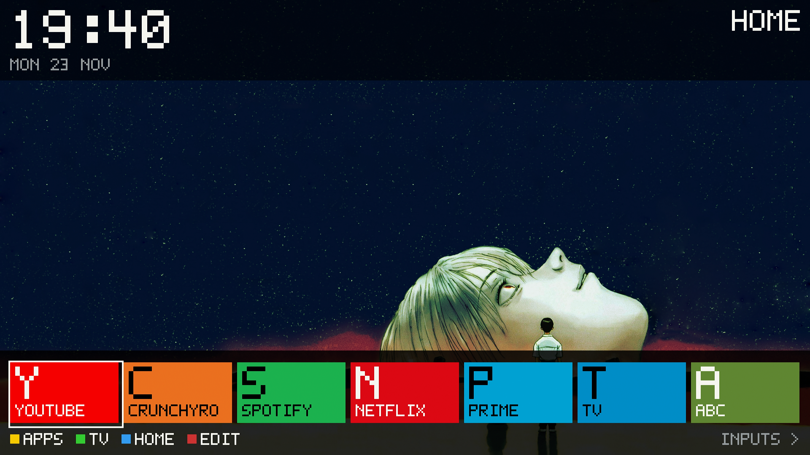
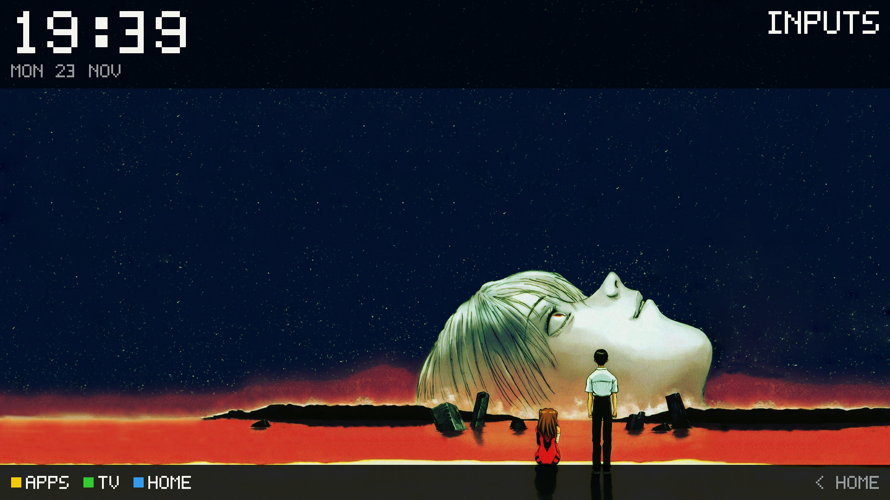
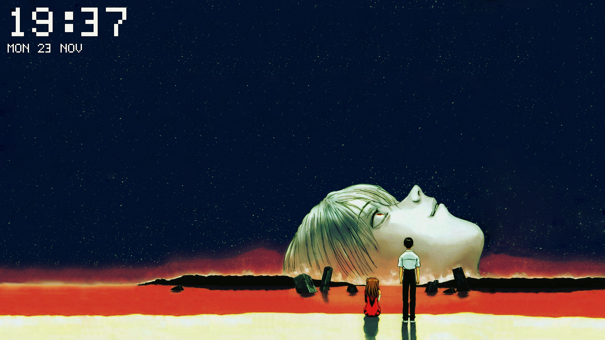
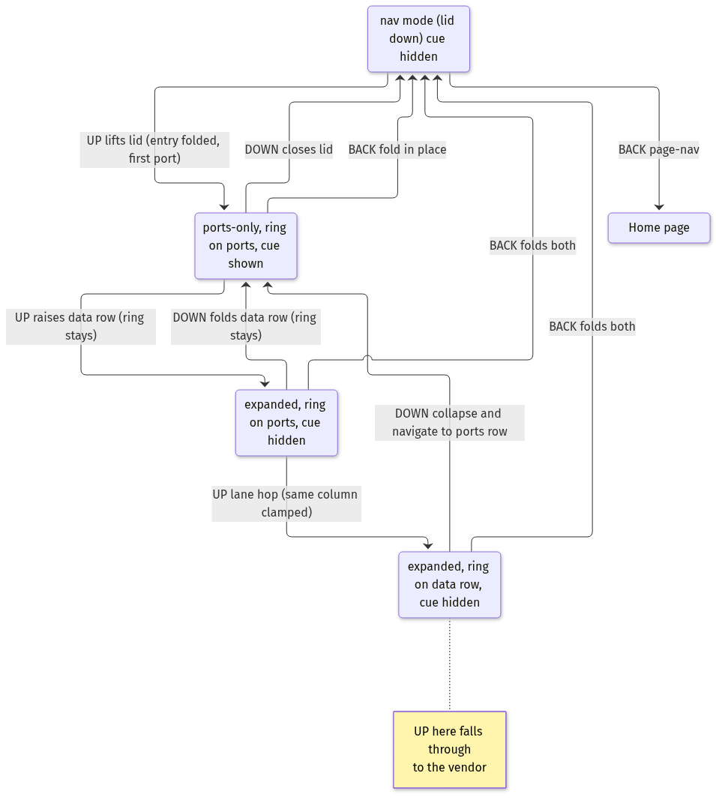
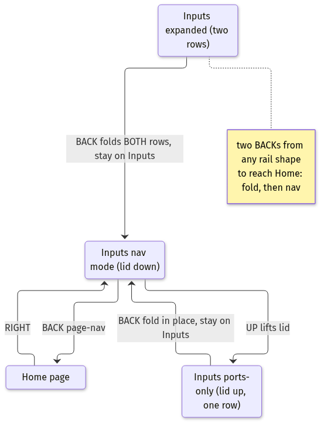

# vidaa-home

A native home-screen replacement for rooted Hisense Vidaa TVs — the UI
lane of a personal firmware-research project on an 85U7SE
(V0000.09.62M.Q0921, MTK9655). It runs **inside the vendor cobalt
runtime** (`/APPS/pkgs/tv.vidaa.app.operationui`), not a webview: the
bundle is a fork of the stock `app.js` extended with our modules, so it
inherits the real platform SDK, storage, and input pipeline.

The look is a teletext/P100 design system: full-page pixel art, one
typeface (13-cell clock, 4-cell date, 5x7 pixel caps), hard boxes,
2 px frames, no rounded corners, no gradients — chrome that folds
into a "lid" and a zen mode that leaves only clock + date on bare
wallpaper (which then bounces around like the DVD logo, if you like
that sort of thing).

## What it looks like

Home page, rail up — pixel clock + date, page cues, favourites rail:



Inputs page — the rail splits into a ports row and a data row, one
selection ring per page:



Zen mode — lid folded after 30 s of silence, chrome fades, only the
clock + date remain on bare art (and with DVD bounce enabled, that
pair drifts and reflects off the screen edges):



The Inputs page rail is a state machine with one ring per page and a
lid that folds/expands under the D-pad; the exact contract, drawn:



BACK-key behaviour from every rail shape:



## What lives where

```
tools/launcher-host/
  native/            the UI: modular ES5 modules 00-kit ... 80-component,
                     concatenated by the builder (wallpaper engine, DVD
                     bounce, settings, rail, input pages)
  build-native-alvidaa.cjs   forks stock app.js + splices in native/
  test-native-modules.cjs    headless fake-runtime: boots the modules,
                     navigates pages, asserts render output (also runs
                     under NATIVE_MIN=1 minified)
tools/wallpaper-sync/
  sync_wallpapers.sh pushes local images to the TV (base64-verified),
  normalizes oversized sources, and bakes the manifest — per-image
  dims + a 16x9 mean-luma grid that lets zen ink follow the art
firmware/
  switch-home.sh     hardened swap tool (stock-integrity gate, cache
                     self-heal, detached relaunch)
  revive.sh          escape hatch if a swap died mid-flight
shots/               design reference + verification shots
```

## Vendor code is not in this repo

`firmware/stock-app.js` — the stock launcher bundle the fork is built
against — is gitignored on purpose: it is Hisense's proprietary code.
To build you supply your own dump; the builder gates on its sha256 so
drift is caught:

```
node tools/launcher-host/build-native-alvidaa.cjs \
  firmware/stock-app.js /tmp/candidate.js \
  7d57be0aa0c1728b19cf315dabab905c090548e3f10747c8e2d4e27a5530868d
```

Tests run with no TV at all:

```
node tools/launcher-host/test-native-modules.cjs
NATIVE_MIN=1 node tools/launcher-host/test-native-modules.cjs
```

Development discipline: one confirmed change per commit; both test
modes green before any build; deploy one step at a time with a
human watching the panel.

Deploy is `firmware/switch-home.sh` over root SSH: it verifies the
stock backup, stages the candidate, and relaunches SystemUI detached.
JS cache dirs are regenerable; the stock `app.js` file is the only
precious rollback artifact.

## Runtime notes worth knowing

- Cobalt, not Chromium: CSS `@keyframes` do not run in this vendor
  fork; only `transition: opacity` does. Motion is JS-tick driven.
- Cobalt storage (`sdk.storage`) lands at component create — prefs
  must be read lazily or the saved choice is lost at boot (this bug
  happened and is fixed; tests guard it).
- The manifest of wallpapers is script-loaded (`<script src>` is
  allowed from the file:// origin; XHR is not).
- `getAllInputsData` device truth: only `deviceName` means a real
  reporting device — never light a tile off a label field.

## Related

The bridge that makes this TV tractable (MQTT control, local HTTP
gateway used for the wallpaper manifest, app launching) is
[carteakey/alvidaa](https://github.com/carteakey/alvidaa); this repo
is the UI that rides on top of it. A companion PR documents the
85U7SE root chain against that project.

## Disclaimer

Personal modding research on hardware we own. Requires a rooted TV
and voids nothing you care about (firmware OTA is deliberately
frozen on the test unit). No warranty; don't run the scripts against
a TV you're not willing to power-cycle.
